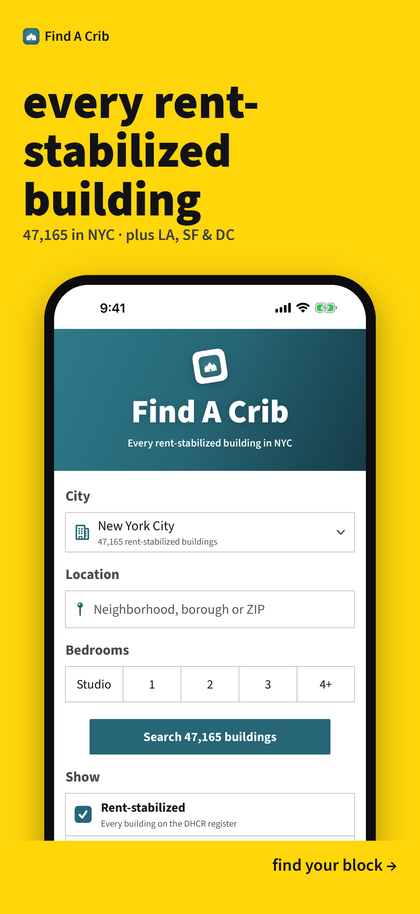
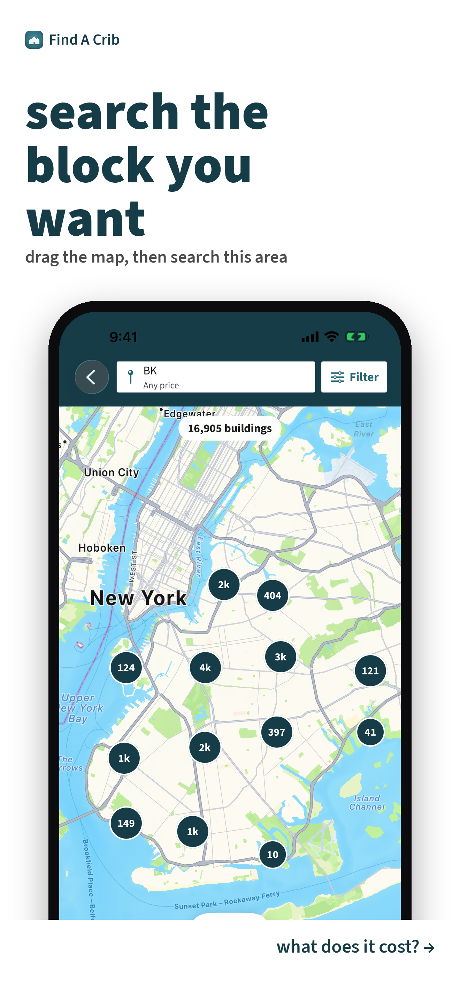
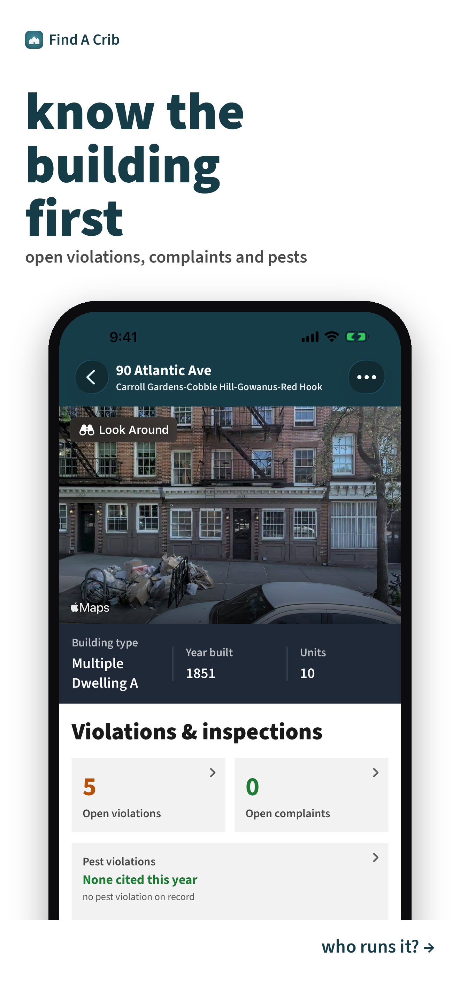
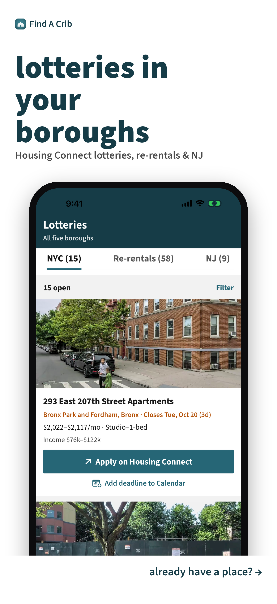

<h1 align="center"> Find A Crib </h1> <br>
<p align="center">
  <a href="https://findacrib.com/">
    
  </a>
</p>

<p align="center">
  The affordable apartments renters can actually get. Built with SwiftUI, Leaflet and Python.
</p>

<p align="center">
  <a href="https://apps.apple.com/us/app/find-a-crib/id6807549249">
    
  </a>
</p>

## Table of Contents

- [Introduction](#introduction)
- [Features](#features)
- [Feedback](#feedback)
- [Build Process](#build-process)
- [How the Code Is Laid Out](#how-the-code-is-laid-out)
- [Changelog](#changelog)
- [Contributing](#contributing)
- [Ground Rules for the Data](#ground-rules-for-the-data)
- [Acknowledgments](#acknowledgments)

## Introduction

[](https://github.com/divinedavis/Find-A-Crib/actions/workflows/ci.yml)
[](https://github.com/divinedavis/Find-A-Crib/actions/workflows/journeys.yml)
[](https://apps.apple.com/us/app/find-a-crib/id6807549249)

Find A Crib maps every rent-stabilized building in New York City, plus rent-controlled and income-restricted housing in San Francisco, Los Angeles, Washington DC and more, and alerts renters the moment a housing lottery or affordable re-rental opens up.

**Available on the web at [findacrib.com](https://findacrib.com) and for iPhone and iPad.**

<p align="center">
  
</p>

## Features

A few of the things you can do with Find A Crib:

- **Map of covered buildings.** Every NYC building on the DHCR rent-stabilization
  rolls, with its HPD owner / managing agent, open violations and complaints.
  SF, LA and DC run on the same front end from each city's own records.
- **Lotteries and re-rentals.** NYC Housing Connect and HCR lotteries, plus
  marketing-agent re-rentals that go first come, first served.
- **Alerts.** Email and iPhone push when a lottery, re-rental or saved
  building matches what you're looking for. Alerts can be filtered by
  borough, household size and income.
- **AI that shows its sources.** A nightly reader turns each listing's flyer
  into a unit table (rent, household size, income limits). Every number it
  extracts must appear in the source text, or that row is dropped
  (`claude_features.ungrounded`).
- **"Do I qualify?"** Checks household size and income against each listing's
  limits.

<p align="center">
  
  
  
  
</p>

## Feedback

Feel free to [file an issue](https://github.com/divinedavis/Find-A-Crib/issues/new). Feature requests are always welcome. If you wish to contribute, please take a quick look at the [guidelines](./CONTRIBUTING.md)!

## Build Process

You need Python 3.14 (what CI runs) and no API keys.

```sh
git clone https://github.com/divinedavis/Find-A-Crib.git
cd Find-A-Crib
python3.14 -m venv .venv && . .venv/bin/activate
pip install requests numpy pillow opencv-python-headless shapely PyJWT segno anthropic cryptography playwright==1.62.0
python3 tests/run_unit.py                 # unit tests (same as CI)
```

To **look at** a front-end change, open the live site with your local files
swapped in. Pages, scripts and styles come from your checkout; the data,
`config.js` and the API come from findacrib.com, so no keys or data build:

```sh
playwright install chromium webkit
python3 scripts/preview.py                   # desktop window; Enter reloads after you save
python3 scripts/preview.py --device phone    # iPhone (WebKit); also --device ipad, --path /sf/
python3 scripts/preview.py --shots shots/after   # phone + desktop + iPad screenshots
```

To **test** a front-end change, run the user-journey suite. It loads **your local
`web/index.html`** over the live site's data in phone, desktop and iPad browsers:

```sh
JOURNEYS_SKIP=account_delete,plus_gates,renter_tools,ai_features python3 tests/journeys.py
```

Large data files (`buildings.slim.json` and friends) are generated and
gitignored. The journey suite fetches them from findacrib.com, so you don't
need to build them.

### Working in a worktree

The owner's checkout uses sibling worktrees (`../dhcr-map-<task>`) so several
branches can be open at once. A fresh worktree has only tracked files; the
ignored data the app, the builders and the iOS tests need stays in the main
checkout. Create one with:

```sh
scripts/new_worktree.sh <task>          # branch + ../dhcr-map-<task> + data
```

It first re-downloads any public data file (the slim and detail building files,
`featured.json`, the iOS seed) that is over a week old in the main checkout
from findacrib.com, then clones the data with `cp -c`: on APFS the copy is
instant and costs no extra disk until one side is modified. Build output lives
in each worktree's `ios/build.nosync`; `scripts/clean_builds.sh` reports what
it would reclaim (dry run by default, `--yes` to empty the idle trees,
`--keep daily` to leave one alone; it never removes `ship-history.jsonl`).

## How the Code Is Laid Out

| Area | Where |
|------|-------|
| Website: everything served at findacrib.com, laid out like the docroot | `web/` (`web/index.html` is the one-file Leaflet app, no build step; `web/static/`, icons, `web/brand/`) |
| City pages + their data | `web/sf/`, `web/la/`, `web/dc/`, `web/westchester/` (pages generated by `pipeline/build_city_pages.py`) |
| Data builders, scrapers, alerts, reports (one script per job) | `pipeline/` |
| Committed data (DHCR PDFs, boundaries, snapshots of the published feeds, curated inputs) | `data/` |
| API (Flask) | `api/` (server + auth); shared modules in `pipeline/`; `deploy/api/` |
| Alerts | `pipeline/lottery_alerts.py`, `pipeline/saved_alerts.py`, `pipeline/apns.py` |
| AI features | `pipeline/flyer_reader.py`, `pipeline/nl_search.py`, `pipeline/claude_features.py`, `pipeline/ai_gateway.py` |
| Database (Supabase / Postgres) | `db/` migrations, `supabase/functions/` |
| iOS app (SwiftUI) | `ios/` (see [ios/README.md](ios/README.md)) |
| Growth engine (SEO pages, outreach) | `growth/`, `pipeline/growth_daily.py` |
| Deploy + cron jobs | `deploy/`, `scripts/deploy_*.sh` |
| Production layout and nginx snapshot | `deploy/README.md`, `deploy/nginx/` |
| Tests | `tests/` |
| Docs, research write-ups, backlog | `docs/` |
| Signage and ad creative | `marketing/` |

More detail:
[data pipeline, alerts and cities](docs/data-pipeline.md) ·
[growth engine](docs/growth-engine.md) ·
[traffic report](docs/traffic-report.md) ·
[backlog](docs/BACKLOG.md)

## Changelog

See the [changelog](CHANGELOG.md) for what changed in each App Store version.

## Contributing

See **[CONTRIBUTING.md](CONTRIBUTING.md)**. In short, fork the repo, open a pull
request, and keep CI green. Issues labelled
[`good first issue`](https://github.com/divinedavis/Find-A-Crib/labels/good%20first%20issue)
are a good place to start.

Found a security problem? Please don't open an issue. See [SECURITY.md](SECURITY.md).

## Ground Rules for the Data

- **No listing-portal data.** The Zumper and StreetEasy feeds were removed on
  2026-10-06 (Zumper's Terms forbid scraping). Building cards link out to
  StreetEasy (NYC) or Zillow (other cities) instead. Don't add a portal scrape.
- **Only cities with property-level records get a map.** See [`docs/BACKLOG.md`](docs/BACKLOG.md) for
  the ones that publish nothing below the town level.
- **No badge never means "no."** Source-of-income discrimination is illegal in
  NYC, so a missing Section 8 badge never means vouchers aren't accepted.

## Acknowledgments

Find A Crib is built on public records. Thanks to the agencies that publish them:

- NYC Rent Guidelines Board / DHCR 2024 building files
- Coordinates from NYC PLUTO
- Owner / managing agent / violations / complaints from NYC Open Data (HPD)
- NYC Housing Connect and NY HCR HousingSearch lotteries
- SF Rent Board Housing Inventory via DataSF (`gdc7-dmcn`)
- LA County Assessor parcel rolls, filtered by LAHD's RSO criteria
- DC DHCD RentRegistry public data exports; DC neighborhood label points (DCGIS)
  and Census 2020 ZCTAs for DC neighborhood/ZIP assignment
- HUD Fair Market Rents and project-based Section 8 contracts
